# Evidencias de avance

Capturas del programa al terminar cada fase del proyecto (Calenda de Oaxaca frente a Santo Domingo).
Las imagenes estan en `docs/evidencias/<fase>/`.

---

## Fase 1 - Escenario base

Plaza con su textura, calle del circuito y bloques de color que se usan provisionalmente en el lugar de Santo Domingo, el kiosco, la fuente y las casas.

| Vista inicial | Santo Domingo |
|---|---|
| 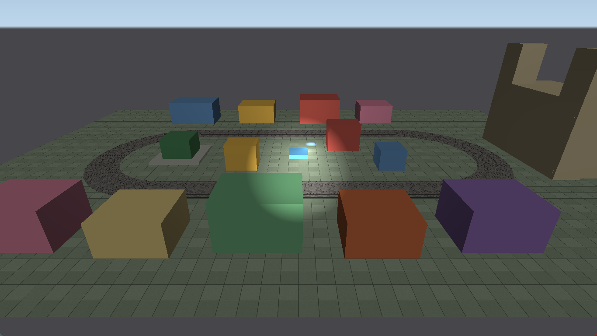 | 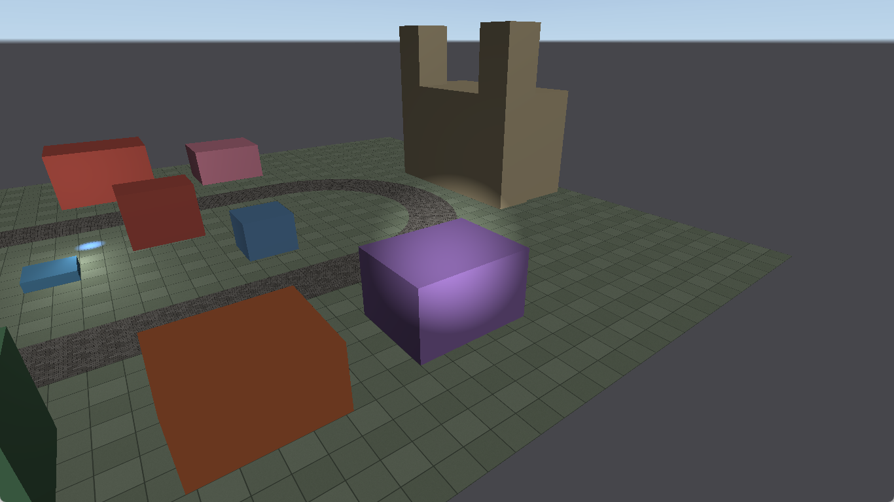 |
| **Kiosco (curva oeste)** | **Calle del circuito desde arriba** |
| 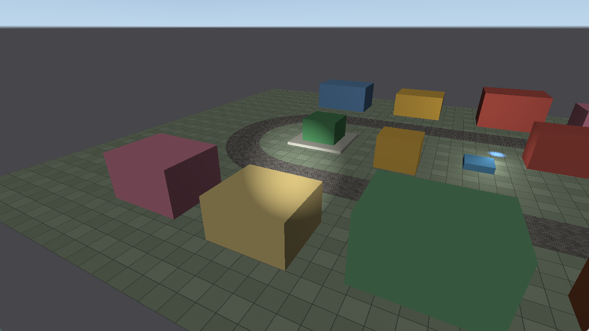 | 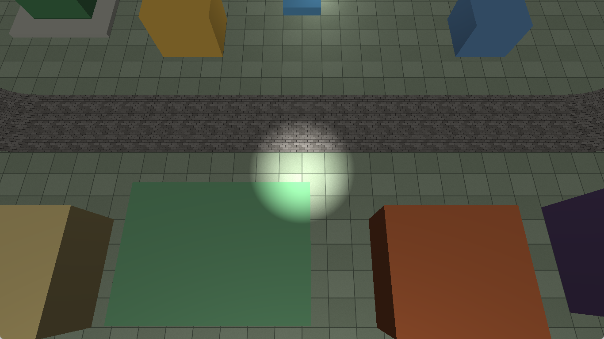 |

## Fase 2 - Atardecer y noche

El programa empieza de tarde, con el cielo naranja y una luz calida que viene del oeste. Con la tecla N cambia a noche: el cielo se oscurece, la luz se vuelve azul y tenue y se prenden las 8 farolas del circuito. La fachada de Santo Domingo y el kiosco tienen cada uno su luz de reflector, que se ve en los dos horarios.

| Tarde | Noche |
|---|---|
| 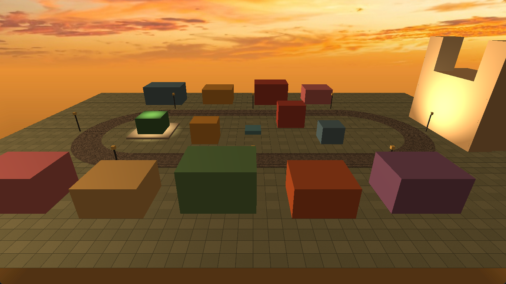 | 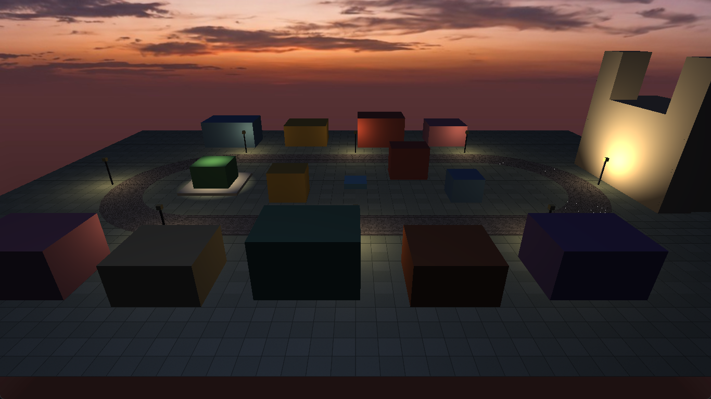 |
| 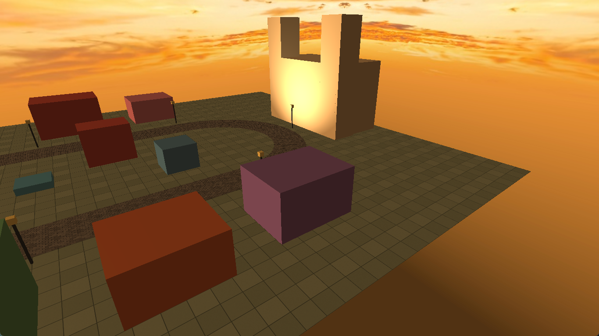 | 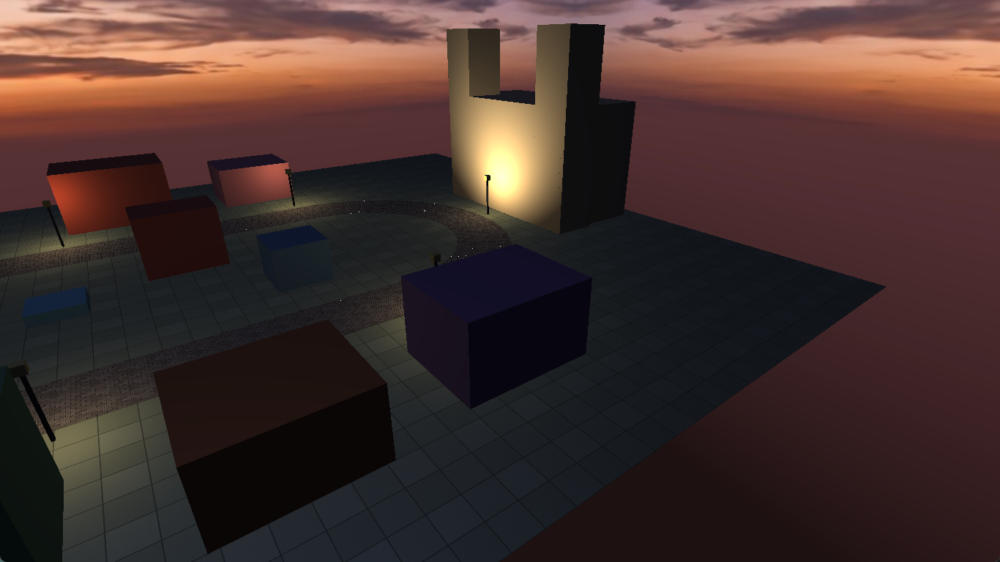 |
| 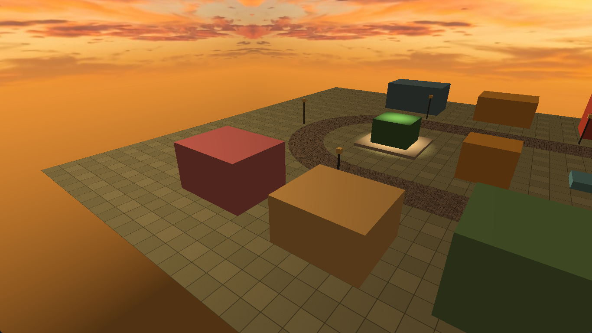 | 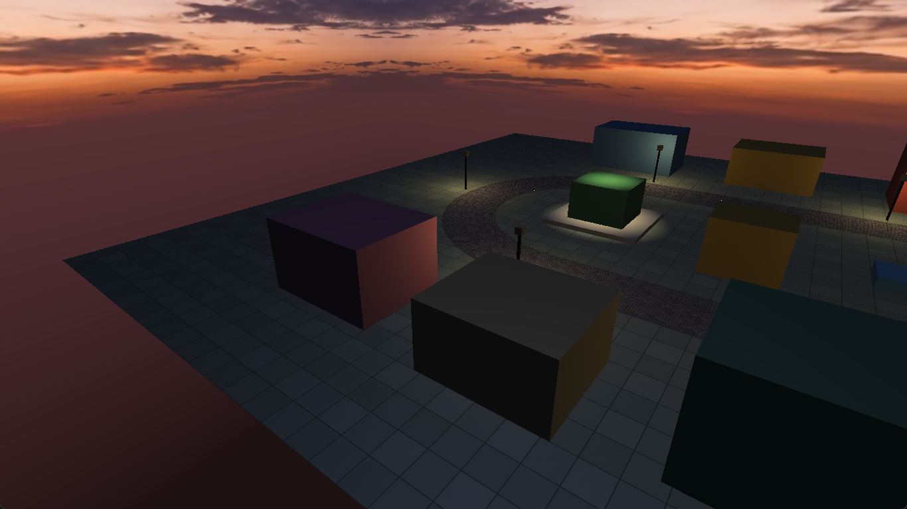 |

Farolas encendidas a lo largo de la recta norte:

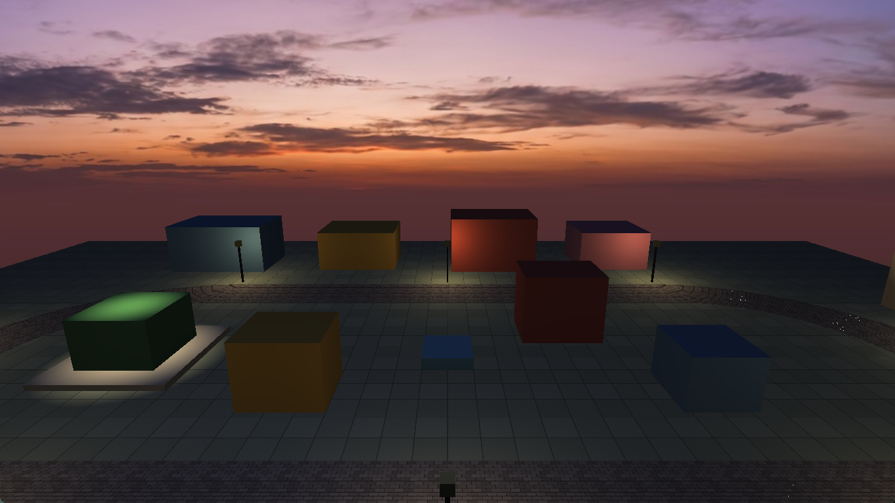

## Fase 3 - Camaras

Con la tecla C se cambia entre tres camaras. La primera es la libre, que se mueve con WASD y el mouse. La segunda esta fija en la plaza y ve de frente la fachada de Santo Domingo. La tercera esta dentro del ovalo y ve de lado la recta sur, por donde va a pasar el desfile. Al regresar a la camara libre queda donde se dejo. Las tres funcionan de tarde y de noche.

| Camara libre (inicial) | Fachada de Santo Domingo |
|---|---|
|  | 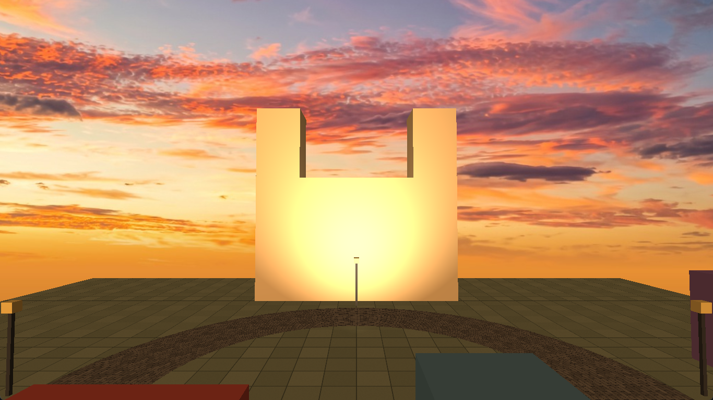 |
| **Lateral del desfile** | **Lateral del desfile de noche** |
|  | 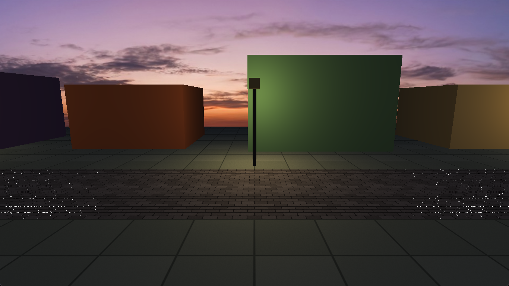 |

Fachada de noche, con el reflector encendido:

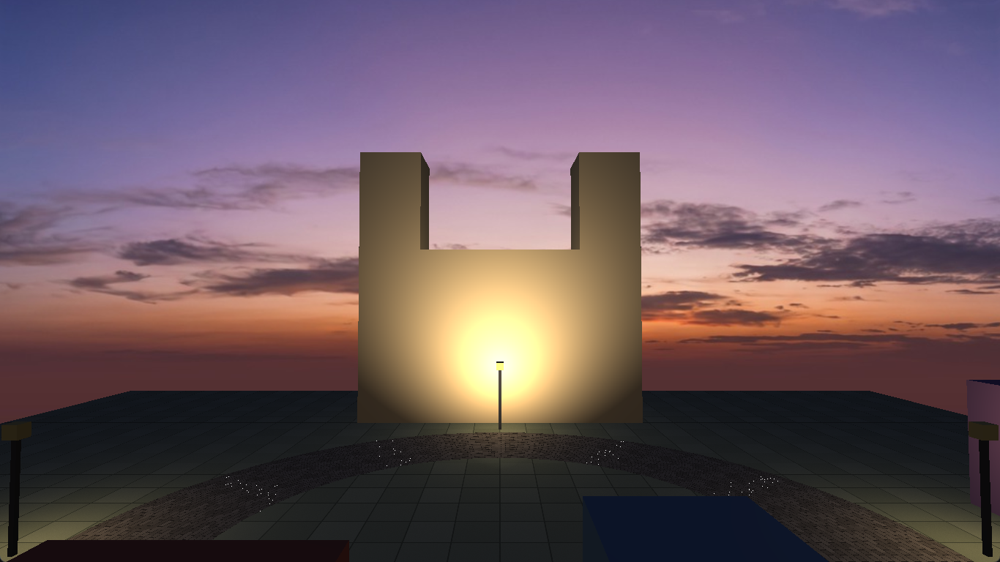

## Fase 4 - Personaje jerarquico

Un muneco hecho con cubos en la recta sur, mirando hacia donde va a avanzar el desfile. Cada parte cuelga de la anterior: el cuerpo es la raiz, de ahi salen la cabeza, los brazos (hombro y codo) y las piernas (cadera y rodilla). Con teclas de prueba se gira cada articulacion y las partes se mueven juntas sin despegarse. Las fotos van en orden y cada una conserva el giro de la anterior.

| Reposo | Hombros (Y/U) |
|---|---|
|  |  |
| **Codos (H/J)** | **Caderas y rodillas (K/L, O/P)** |
|  | 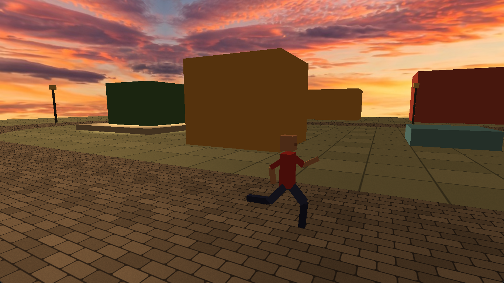 |
| **Cabeza (Z/X)** | **Desde la camara del desfile** |
|  | 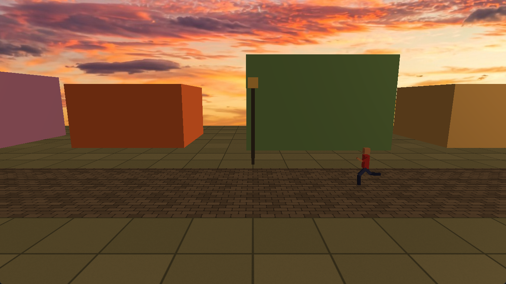 |
